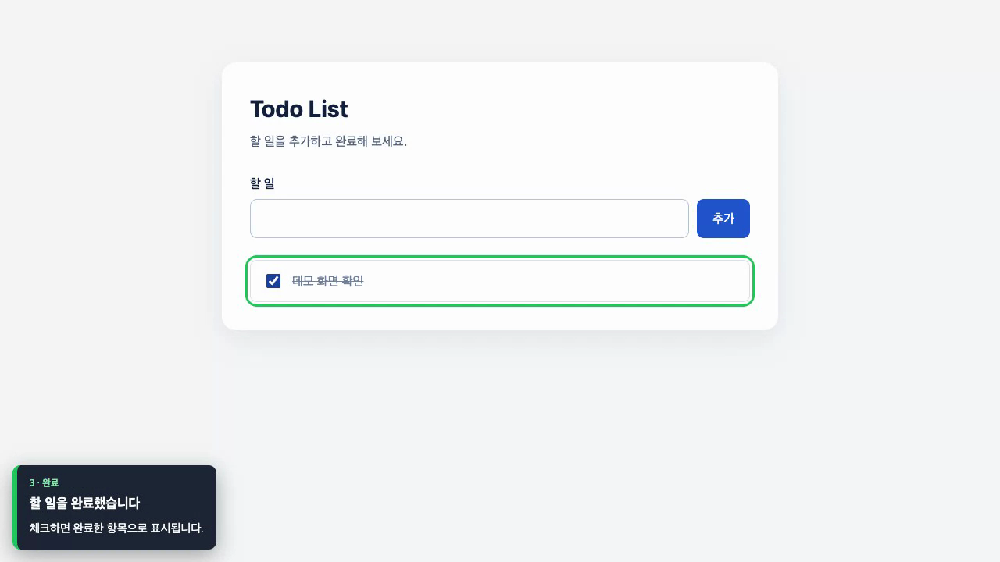
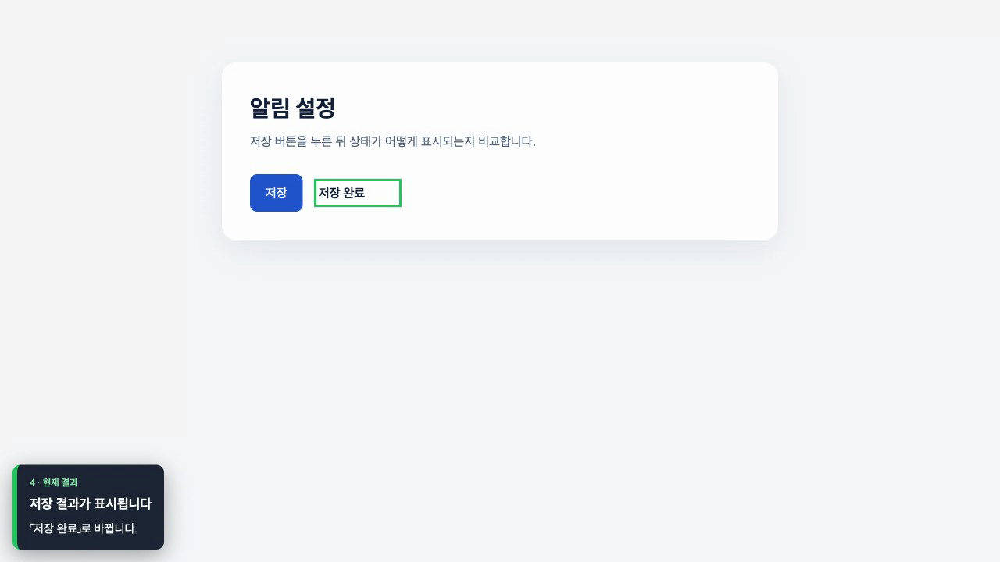

# Web Feature Demo

로컬 웹 서비스를 Chrome에서 한국어 설명과 하이라이트로 시연하고, 선택하면 WebM으로 녹화하는 스킬입니다.

**버전:** v1.0.0 · **호스트:** Claude Code · **라이선스:** MIT

[설치](#설치) · [사용법](#사용법) · [예시](#예시) · [검증](#검증)

현재 검증한 운영체제는 macOS입니다. 시연은 테스트 판정이 아니며, 테스트는 별도로 실행해야 합니다.

## 소개

로컬에서 실행 중인 웹 서비스의 기능 변경과 사용자 흐름을 장면별로 보여줍니다.

- 장면마다 한국어 설명과 화면 하이라이트를 표시합니다.
- 필요한 화면이 보이는지 먼저 확인하고 Chrome에서 재생합니다.
- 로그인 생략, 시연 전 로그인, 로그인 과정 포함 중에서 선택합니다.
- 원하면 웹페이지를 WebM으로 저장하고, 시연 뒤 등록된 데모 데이터를 정리합니다.

대상 서비스의 소스나 실행 중인 서버를 데모 때문에 바꾸지 않습니다.

## 설치

Claude Code, Node.js 20 이상, Google Chrome이 필요합니다. 데모할 서비스도 로컬에서 실행해 두세요.
설치 단위는 **저장소 루트 전체**이며, 설치 폴더 이름은 **`web-feature-demo`**입니다.

```sh
mkdir -p "${CLAUDE_CONFIG_DIR:-$HOME/.claude}/skills"
git clone https://github.com/ChoMinGi/claude-code-web-feature-demo-skill.git \
  "${CLAUDE_CONFIG_DIR:-$HOME/.claude}/skills/web-feature-demo"
```

Claude Code를 다시 시작하세요. `/web-feature-demo` 명령이 보이면 설치된 것입니다.
ZIP을 받았다면 압축을 푼 폴더 이름을 `web-feature-demo`로 맞추고 같은 `skills/` 폴더에 복사하세요.
기존 설치가 있다면 먼저 비교하고 백업하세요.

Playwright는 따로 설치할 필요가 없습니다. 서비스의 Playwright가 1.59보다 오래됐거나
없으면 첫 실행 때 `${XDG_CACHE_HOME:-$HOME/.cache}/web-feature-demo`에 별도 실행기를 설치합니다.
최초 설치와 녹화 준비에는 인터넷 연결이 필요할 수 있습니다.

## 사용법

로컬 서버를 켜고, 주소와 보여줄 흐름을 Claude Code에 말하세요.

```text
/web-feature-demo http://localhost:3000 회원가입 흐름 보여줘
/web-feature-demo http://localhost:3000 결제 화면 변경 사항 보여줘. 영상도 저장해줘
```

스킬은 장면 순서와 예상 길이를 먼저 제안합니다. 녹화 여부나 로그인 범위가 정해지지 않았다면
함께 확인합니다. 장면을 창 없이 한 번 확인한 뒤 Chrome에서 재생하며, 필요한 화면이 보이지 않으면 멈춥니다.
재생이 끝나도 창은 열려 있습니다. 창을 닫으면 명령이 종료됩니다.

환경 변수와 로그인 옵션은 [설정 안내](docs/configuration.md)에 있습니다.

## 예시

### 할 일 추가·완료

[](examples/sample.webm)

[영상 보기](examples/sample.webm) · 약 7초. 계정이나 API 없이 실행할 수 있습니다.

### 수정 전후 비교

[](examples/before-after.webm)

[영상 보기](examples/before-after.webm) · 약 17초. Vite에서 수정 전 모듈과 현재 모듈을 같은 창에서 비교합니다.

[예제 실행 안내](docs/examples.md)에 서버 시작, 사전 확인, 재생, 녹화 명령을 정리했습니다.
명령은 저장소 루트에서 실행합니다.

## 구성

```text
SKILL.md       Claude Code가 읽을 스킬 지침
scripts/       실행기, 브라우저 도구, 어댑터와 장면 템플릿
references/    장면 구성, 서비스별 어댑터, 수정 전후 비교 지침
examples/      실행 가능한 예제 앱, 스크린샷과 영상
tests/         로그인, 네트워크 차단, 종료·정리 검사
docs/          예제 실행과 설정 안내
```

## 검증

저장소 루트에서 실행합니다. 예제 서버가 이미 실행 중이라면 먼저 종료하세요.

```sh
bash tests/smoke.sh
DEMO_DIR="$(bash scripts/install.sh)" node tests/lifecycle.mjs
```

스모크 검사는 Todo List, 로그인 3가지 모드, 데이터 정리, 화면 확인 실패,
외부 HTTP·WebSocket 차단을 확인합니다. 수명 주기 검사는 창 닫기, 종료 신호, 시간 만료,
`KEEP=1` 동작을 확인합니다. 검사에는 Chrome과 실행기가 필요합니다.

이 검사는 스킬 도구를 확인하며, 시연 대상 서비스의 기능 테스트를 대신하지 않습니다.
시연과 녹화 방법은 [예제 실행 안내](docs/examples.md)에 있습니다.

## 제한 사항과 개인정보

- `DEMO_URL`, `DEMO_LOGIN_URL`, `DEMO_API`에는 로컬 주소만 쓸 수 있습니다:
  `localhost`, `*.localhost`, `127.0.0.0/8`, `[::1]`.
  브라우저의 외부 HTTP(S)·WebSocket 연결도 막지만 백엔드가 보내는 요청은 막지 않습니다.
- 일반적인 이메일·비밀번호 폼이 아니면 서비스별 어댑터가 필요합니다.
  외부 인증 페이지를 거치는 SSO와 2단계 인증은 로컬 연결 제한 때문에 재생할 수 없습니다.
- 비밀번호와 토큰은 스크립트에 적지 말고 환경 변수로 전달하세요. 로그인 과정을 녹화하면
  화면과 입력 과정도 영상에 담깁니다. 데모 계정을 쓰고 공유 전에 파일을 확인하세요.
- 창을 닫거나 30분이 지나면 등록한 데이터 정리를 실행합니다. `SIGINT`·`SIGTERM` 때도
  정리를 시도하지만 `SIGKILL`에서는 실행되지 않을 수 있습니다. `KEEP=1`이면 데이터를 남깁니다.
- 같은 창에서 수정 전후를 전환하려면 Vite 개발 서버가 필요합니다.
  다른 환경에서는 이전 커밋을 별도 포트에서 실행합니다.
- 영상에는 1280×720 크기의 웹페이지만 담깁니다. 주소창·다른 앱·데스크톱은 나오지 않습니다.
  `DRY=1`에서는 녹화하지 않습니다.

## 문서

- [예제 실행과 녹화](docs/examples.md) · [환경 변수와 로그인 설정](docs/configuration.md)
- [장면 구성](references/brief.md) · [서비스별 어댑터](references/adapters.md)
- [수정 전후 비교](references/before-after.md) · [문제 해결](references/pitfalls.md)
- [변경 기록](CHANGELOG.md)
- [README 작성 기준](docs/presentation-guide.md)

## 라이선스

[MIT](LICENSE).
