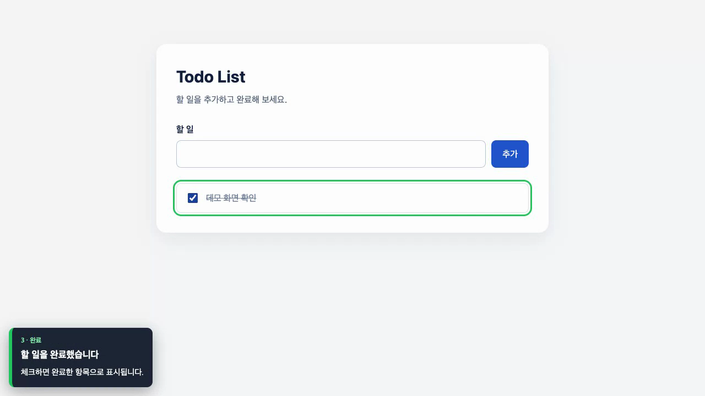
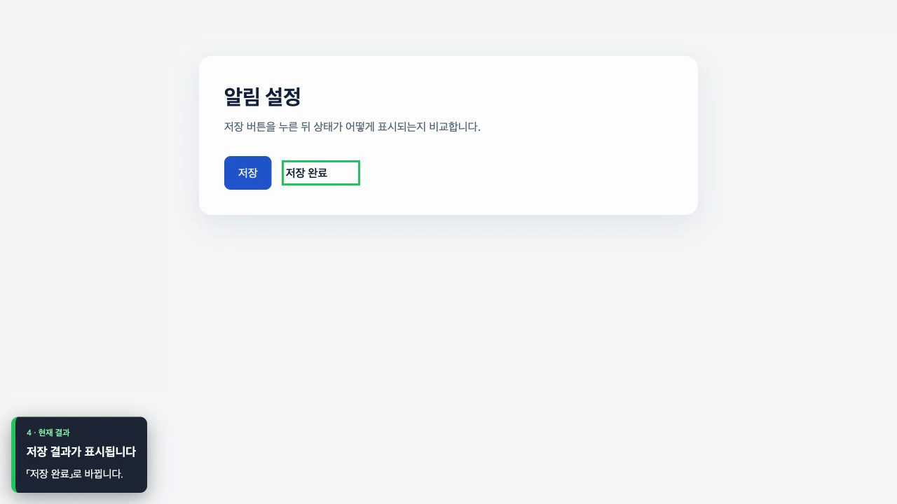

# web-feature-demo — Claude Code 스킬

로컬에서 실행 중인 웹 서비스를 Claude Code가 Chrome으로 보여주는 스킬입니다. 장면마다 한국어 설명과 하이라이트를 띄우고, 원하면 웹페이지를 WebM으로 녹화합니다.

현재 버전: **1.0.0**

### 할 일 추가·완료

[](examples/sample.webm)

[영상 보기](examples/sample.webm) · 약 7초

### 수정 전후 비교

[](examples/before-after.webm)

[영상 보기](examples/before-after.webm) · 약 17초

## 설치

Claude Code, Node.js 20 이상, Google Chrome이 필요합니다. 데모할 서비스도 로컬에서 실행해 두세요. 현재 검증한 운영체제는 macOS입니다.

저장소를 스킬 폴더에 받습니다.

```bash
mkdir -p "${CLAUDE_CONFIG_DIR:-$HOME/.claude}/skills"
git clone https://github.com/ChoMinGi/claude-code-web-feature-demo-skill.git \
  "${CLAUDE_CONFIG_DIR:-$HOME/.claude}/skills/web-feature-demo"
```

Claude Code를 다시 시작하세요. `/web-feature-demo` 명령이 보이면 설치된 것입니다. ZIP 파일을 받았다면 압축 안의 `web-feature-demo` 폴더를 같은 `skills/` 폴더에 복사하세요.

Playwright는 따로 설치할 필요가 없습니다. 서비스의 Playwright가 1.59보다 오래됐거나 설치되지 않았다면 첫 실행 때 `~/.cache/web-feature-demo`에 별도 실행기를 설치합니다. 최초 설치와 녹화 준비에는 인터넷 연결이 필요할 수 있습니다.

## 예제 실행

예제로 포함된 Todo List는 할 일을 추가하고 완료합니다. 계정이나 API 없이 실행할 수 있습니다.

첫 번째 터미널에서 예제 서버를 켭니다.

```bash
node examples/sample-app.mjs
```

다른 터미널에서 장면을 확인합니다.

```bash
DEMO_DIR="$(bash scripts/install.sh)"
DRY=1 node "$DEMO_DIR/sample.mjs"
```

`CHECKS 3/3 OK`가 나오면 Chrome에서 재생합니다.

```bash
node "$DEMO_DIR/sample.mjs"
```

재생이 끝나도 창은 열려 있습니다. 창을 닫으면 명령이 종료됩니다. 영상을 저장하려면 녹화 준비 단계부터 `RECORD=1`을 붙입니다.

```bash
DEMO_DIR="$(RECORD=1 bash scripts/install.sh)"
RECORD=1 DRY=1 node "$DEMO_DIR/sample.mjs"
RECORD=1 node "$DEMO_DIR/sample.mjs"
```

예제 서버를 끈 뒤 `bash tests/smoke.sh`를 실행하면 Todo List, 로그인 3가지 모드, 데이터 정리, 화면 확인 실패, 외부 HTTP·WebSocket 차단을 검사할 수 있습니다. 창 닫기, 종료 신호, 시간 만료, `KEEP=1` 동작은 `DEMO_DIR="$(bash scripts/install.sh)" node tests/lifecycle.mjs`로 확인합니다.

두 번째 영상은 Vite에서 수정 전 모듈을 띄운 뒤 같은 창에서 현재 모듈로 전환합니다. 예제 서버를 켜려면 처음 한 번 Vite를 설치해야 합니다.

```bash
npm --prefix examples/before-after install
npm --prefix examples/before-after run dev
```

다른 터미널에서 시연합니다.

```bash
DEMO_DIR="$(RECORD=1 bash scripts/install.sh)"
RECORD=1 DRY=1 node "$DEMO_DIR/before-after.mjs"
RECORD=1 node "$DEMO_DIR/before-after.mjs"
```

## 사용 방법

로컬 서버를 켜고, 주소와 보여줄 흐름을 Claude Code에 말하세요.

```text
/web-feature-demo http://localhost:3000 회원가입 흐름 보여줘
/web-feature-demo http://localhost:3000 결제 화면 변경 사항 보여줘. 영상도 저장해줘
```

스킬은 장면 순서와 예상 길이를 먼저 제안합니다. 녹화 여부나 로그인 범위가 정해지지 않았다면 함께 확인합니다. 장면을 창 없이 한 번 확인한 뒤 Chrome에서 재생하며, 필요한 화면이 보이지 않으면 멈춥니다.

## 설정

| 환경 변수 | 용도 |
|---|---|
| `DEMO_URL` | 데모할 로컬 화면 주소. 필수 |
| `DEMO_LOGIN_URL` | 로그인 화면 주소. 생략하면 `DEMO_URL` 사용 |
| `DEMO_LOGIN_MODE` | `none`: 로그인 생략, `before`: 먼저 로그인, `show`: 로그인 과정부터 재생 |
| `DEMO_USER`, `DEMO_PASSWORD` | 로그인 계정. 로그인할 때는 둘 다 필요 |
| `DEMO_API` | 별도 로컬 API 주소 |
| `DEMO_TOKEN` | API에 Bearer 토큰이 필요할 때만 사용 |
| `RECORD=1` | 웹페이지를 WebM으로 저장 |
| `DEMO_VIDEO_PATH` | 영상 저장 경로. 생략하면 실행 폴더에 날짜가 붙은 파일 생성 |
| `KEEP=1` | 데모 데이터 정리 생략 |
| `PACE=0.5` | 장면 설명 시간을 절반으로 줄임 |

`DEMO_LOGIN_MODE`를 생략하면 계정 정보가 있을 때 `before`, 없을 때 `none`으로 실행합니다. 일반적인 이메일·비밀번호 폼이 아니면 서비스에 맞는 어댑터가 필요합니다. 외부 인증 페이지를 거치는 SSO나 2단계 인증은 로컬 연결 제한 때문에 재생할 수 없습니다.

비밀번호와 토큰은 스크립트에 적지 말고 환경 변수로 전달하세요. `show` 모드에서 녹화하면 로그인 화면과 입력 과정도 영상에 담깁니다. 공유할 영상에는 데모 계정을 쓰고, 저장된 파일을 확인하세요.

## 제한 사항

- `DEMO_URL`, `DEMO_LOGIN_URL`, `DEMO_API`에는 로컬 주소만 쓸 수 있습니다: `localhost`, `*.localhost`, `127.0.0.0/8`, `[::1]`. 브라우저의 외부 HTTP(S)·WebSocket 연결도 막습니다. 백엔드가 보내는 요청은 막지 않으니 백엔드 설정은 따로 확인하세요.
- 재생 후에도 Chrome은 열려 있습니다. 창을 닫거나 30분이 지나면 등록한 데이터 정리 작업을 실행합니다. `SIGINT`·`SIGTERM` 때도 정리를 시도하지만 `SIGKILL`에서는 실행되지 않을 수 있습니다.
- 수정 전후 화면을 같은 창에서 전환하려면 Vite 개발 서버가 필요합니다. 다른 환경에서는 이전 커밋을 별도 포트에서 실행합니다.
- 영상에는 1280×720 크기의 웹페이지만 담깁니다. 주소창·다른 앱·데스크톱은 나오지 않습니다. `DRY=1`에서는 녹화하지 않습니다.
- 테스트는 별도로 실행해야 합니다.

## 라이선스

[MIT](LICENSE)
